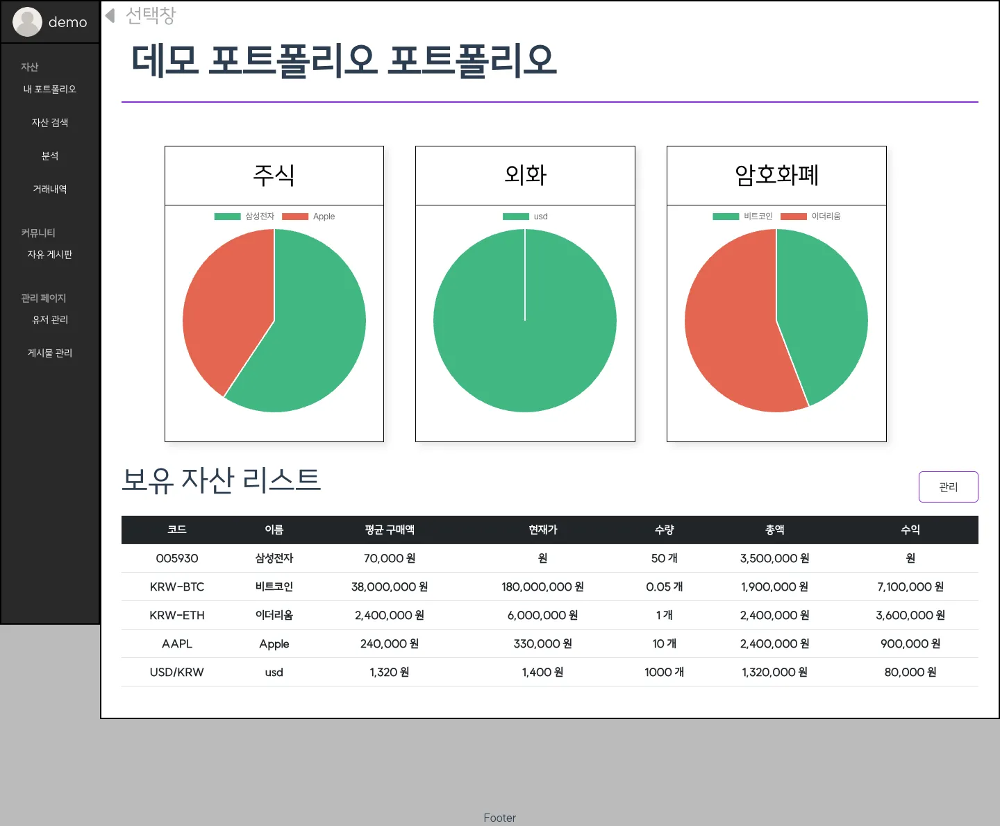
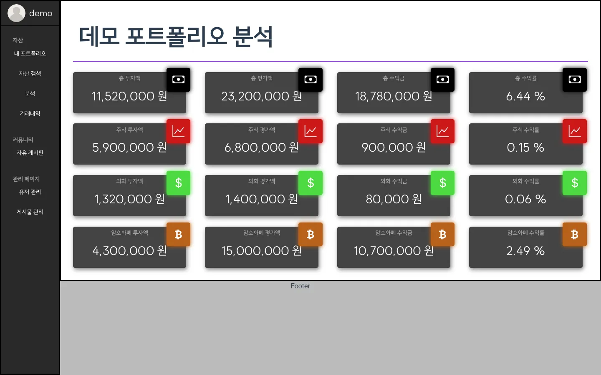
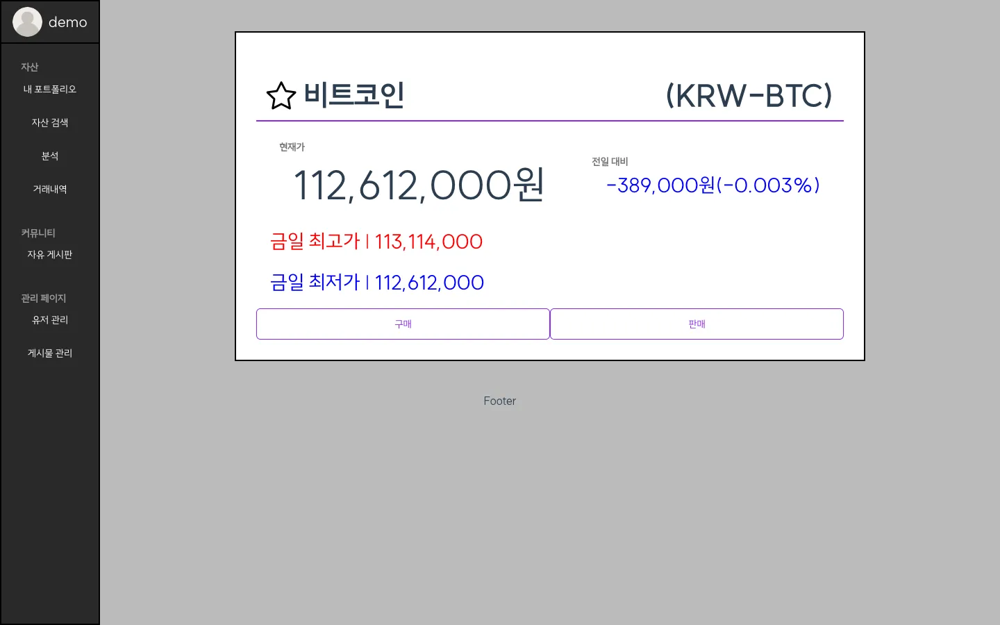
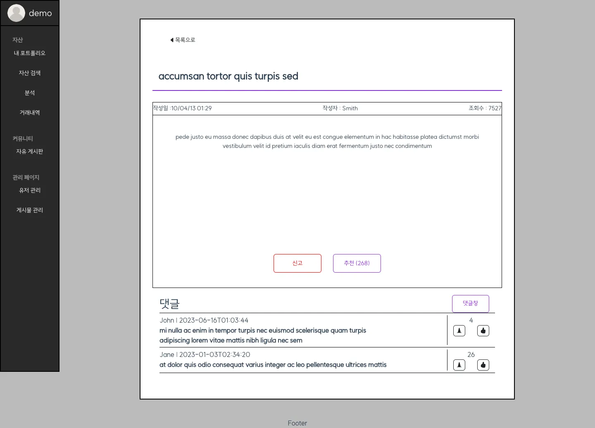

# My Asset Manager (2023)

> **2023년 개인 프로젝트를 기록으로 남겨 둔 저장소입니다.** 유지보수하지 않고, 운영 중인 서비스도 아닙니다. 현재 상태는 [2026-10-10 기준 상태](#2026-10-10-기준-상태) 절에 정리했습니다.

본인이 실제로 가진 자산이나 임의로 짠 포트폴리오를 등록해 두고, 자산 상태와 투자 성과를 한곳에서 보는 웹 애플리케이션입니다.

- **기간**: 2023.07.28 ~ 2023.08.20 (약 3주, 1인)
- **동기**: 스프링부트에 익숙해지고 DB(서버)와 클라이언트 사이의 데이터 흐름을 직접 만들어 보는 것이 목표였습니다. 그리고 **처음 보는 기술에 ChatGPT를 써서 얼마나 빨리 적응할 수 있는지 시험해 보고 싶었습니다.** Vue는 이 프로젝트에서 처음 썼습니다. 기능 설계, API 설계, ERD 초안은 ChatGPT와 의논하며 정했고, 구현도 ChatGPT 예시 코드에서 출발했습니다.

## 데모 영상 (2023)

- 주요 기능(자산·포트폴리오): https://youtu.be/nK9Wwt1JDaI
- 부가 기능(게시판·로그인 등, 1차 구현 최종): https://youtu.be/Gmr1G4QhKCk
- 프론트 1차 버전: https://youtu.be/RsGuS_yjSlI

## 스크린샷 (2026-10-10, 데모 데이터)

| 포트폴리오 상세 | 포트폴리오 분석 |
|---|---|
|  |  |
| **암호화폐 상세 (Upbit 실시간 시세)** | **게시판 상세** |
|  |  |

MariaDB 대신 H2(MariaDB 호환 모드)에서 앱을 띄우고 데모 데이터를 넣어 찍었습니다. 분석 화면의 합계와 수익률 숫자는 계산 버그 때문에 틀리게 나옵니다(아래 "알려진 문제" 참고).

## 기능

- **자산**: 국내·해외 주식 검색과 상세, 외화, 암호화폐(Upbit), 직접 입력하는 기타 자산, 즐겨찾기, 매수·매도
- **포트폴리오**: 여러 포트폴리오 만들기와 삭제, 자산군별 비중 차트, 보유 자산 목록과 관리, 분석(투자액·평가액·수익·수익률), 거래 내역
- **커뮤니티**: 게시판(검색·정렬), 댓글, 추천·신고
- **계정**: 회원가입, 로그인(세션), 내 정보(프로필 이미지), 내 활동, 탈퇴
- **관리자**: 유저 정지·탈퇴 처리, 게시물 숨김·삭제
- 가격 갱신 스케줄러(12시간 간격), Swagger 문서(`/api-docs`)

## 기술 스택

- **프론트엔드**: Vue 3 (Options API), Vue Router 4, axios, Chart.js (vue-chartjs), SCSS, Bootstrap 5 / Bootstrap Icons
- **백엔드**: Java 17, Spring Boot 3.1, Spring Security 6.1 (폼 로그인 + 세션, BCrypt), Spring Data JPA (Hibernate 6.2), Caffeine 캐시, springdoc-openapi (Swagger)
- **DB**: MariaDB
- **외부 시세 API**: 한국투자증권 OpenAPI(국내 주식, 실시간 WebSocket), 공공데이터포털 주식시세정보(종목명), Alpha Vantage(해외 주식), Upbit(암호화폐), fawazahmed0 currency-api(환율)
- **설계 도구**: ChatGPT(기능·API 설계 토론), 카카오 오븐·Padlet(화면), dbdiagram.io(ERD)

## 실행 방법

기록을 위해 적어 둡니다. 2026년 기준으로 동작을 보장하지 않습니다.

**필요한 것**
- JDK 17. Gradle 8.2.1 래퍼는 JDK 21 이상에서 돌지 않습니다.
- MariaDB: `asset-port` 데이터베이스와 계정
- Node 18 이상: 프론트를 다시 빌드할 때만 필요합니다.

**설정**

`src/main/resources/application.yml`의 값은 비워 두었습니다. 아래 환경 변수로 넣어 주세요(Spring 표준 이름 규칙). 키 값은 저장소에 들어 있지 않습니다.

| 환경 변수 | 용도 |
|---|---|
| `SPRING_DATASOURCE_URL` | 기본값 `jdbc:mariadb://localhost:3306/asset-port` |
| `SPRING_DATASOURCE_USERNAME` / `SPRING_DATASOURCE_PASSWORD` | DB 계정 |
| `EXTERNAL_API_APPKEY` / `EXTERNAL_API_APPSECRETKEY` | 한국투자증권 OpenAPI (국내 주식 시세·실시간) |
| `EXTERNAL_DATAGO_SERVICEKEY` | 공공데이터포털 주식시세정보 (국내 종목명) |
| `EXTERNAL_ALPHAVANTAGE_APIKEY` | Alpha Vantage (해외 주식) |

키가 없어도 앱은 뜹니다. 다만 국내·해외 주식 화면은 동작하지 않고, 시작할 때 가격 갱신 작업이 403 오류를 로그에 남깁니다.

**실행**

```bash
# 백엔드 (빌드된 프론트가 src/main/resources/static에 포함되어 있습니다)
sh ./gradlew bootRun          # gradlew에 실행 권한이 없어서 sh로 실행합니다
# → http://localhost:8080

# 프론트를 다시 빌드할 때
cd front
npm ci
npx vue-cli-service build     # npm run build는 --watch라서 끝나지 않습니다
# 개발 서버: npm run serve → http://localhost:3000 (/api는 8080으로 프록시)
```

- 스키마는 `ddl-auto: create-drop`이라 **재시작할 때마다 모든 데이터가 지워지고** `sql/data.sql` 시드(목업 유저 102명, 게시글·댓글 각 100개)가 다시 들어갑니다.
- 시드 계정의 비밀번호는 문서화되어 있지 않습니다. 회원가입으로 새 계정을 만들어 쓰세요. 관리자 권한은 `user_roles`에 `ROLE_ADMIN`(roles_idx 2)을 직접 넣어야 생깁니다.
- `./gradlew test`는 실제로는 테스트를 하나도 실행하지 않습니다(`useJUnitPlatform()` 누락).

## 2026-10-10 기준 상태

**이 저장소는 2023년 시점의 기록입니다.** 더 이상 손보지 않고, 공개 서비스로 배포할 계획도 없습니다. 2026-10-10에 다시 빌드하고 실행해서 점검했고, 자세한 내용은 [docs/review-2026-10-10.md](docs/review-2026-10-10.md)에 있습니다. 이번 점검에서 고친 것은 첫 부팅을 막던 `data.sql` 두 줄뿐입니다.

### 알려진 문제

- **보안**
  - 로그인하지 않아도 누구나 게시글을 수정할 수 있습니다(소유자 확인 없음).
  - 다른 사용자의 포트폴리오를 조회할 수 있고, 매수·매도·보유 삭제 요청도 소유자를 확인하지 않습니다.
  - 탈퇴한 계정으로 다시 로그인할 수 있습니다(만료 판정 로직이 반대로 되어 있음).
  - 입력 검증이 아예 동작하지 않습니다(`spring-boot-starter-validation` 누락). 빈 비밀번호로도 가입됩니다.
  - CSRF 보호가 꺼져 있고, Alpha Vantage 키를 브라우저로 내려보냅니다.
  - 2023년 커밋 기록에 외부 API 키가 남아 있습니다(이후 커밋에서 값만 지움).
- **기능 버그**
  - 사용자 id가 128 이상이면 자기 포트폴리오 상세와 거래 내역에 접근하지 못합니다(`Long`을 `!=`로 비교).
  - 분석 화면의 총수익이 이중으로 합산되고, 총수익률은 각 행의 수익률을 단순히 더한 값입니다. 수익률은 비율 값에 `%`만 붙여 표시해서 100배 작게 보입니다.
  - 부분 매도 후에는 평균 매입가가 틀어집니다(매입 원가 대신 매도 금액을 뺌). 매수·매도가 트랜잭션으로 묶여 있지 않습니다.
  - 추천·신고는 사용자당 한 번만 됩니다(복합키 컬럼마다 unique가 걸림). 255자가 넘는 게시글·댓글은 저장되지 않습니다.
  - 관리자 유저 목록이 시드 데이터에서 500 오류를 냅니다(`created_at`이 null).
- **외부 API**
  - 환율 API(fawazahmed0 `currency-api@1`)가 404를 돌려줘서 외화 화면이 동작하지 않습니다.
  - 국내·해외 주식 화면은 API 키가 있어야 합니다. 실시간 시세는 한국투자증권의 테스트용 `ws://` 경로를 씁니다.
  - Upbit(암호화폐)만 키 없이 동작합니다.
- **성능·UI**
  - 게시판 목록 요청 한 번에 SQL이 166개 나갑니다(EAGER 로딩, N+1). 페이지네이션이 없습니다.
  - 메인 배경 이미지가 9.9MB입니다.
  - 화면 크기를 vw 단위로 잡아서 모바일 레이아웃이 깨집니다. 오류 표시가 대부분 `alert()`입니다.
- **플랫폼**
  - Spring Boot 3.1은 2024년에 OSS 지원이 끝났습니다. jackson-databind가 취약한 2.13.0 버전에 고정되어 있습니다.
  - Vue CLI는 유지보수 모드입니다.

이 문제들은 고치지 않고 그대로 둡니다. **이 저장소는 3주 동안 처음 보는 기술로 끝까지 만들어 본 경험을 남겨 두는 기록**이고, 실제로 쓰는 서비스가 아닙니다.

---

## 日本語（概要）

**My Asset Manager** は、2023年7月28日〜8月20日の約3週間で一人で作った資産ポートフォリオ管理Webアプリです。Vue 3 と Spring Boot で作りました。Vue はこのプロジェクトで初めて使い、「ChatGPT を使って未経験の技術にどれだけ早く慣れられるか」を試すことも目的の一つでした。

- 機能：国内・海外株、為替、暗号資産（Upbit）の検索と売買記録、複数ポートフォリオ、資産配分チャート、分析、取引履歴、掲示板、管理者ページ
- 技術：Vue 3、Spring Boot 3.1、Spring Security、JPA、MariaDB、Chart.js、Bootstrap
- デモ動画：https://youtu.be/nK9Wwt1JDaI ・ https://youtu.be/Gmr1G4QhKCk ・ https://youtu.be/RsGuS_yjSlI

**2026-10-10 時点の状態**：このリポジトリは**メンテナンスしておらず、稼働中のサービスでもありません**。2023年当時の記録として残しています。既知の問題は修正していません。

- 認可チェックの欠落（未ログインでの投稿編集、他ユーザーのポートフォリオ参照）
- 分析画面の集計ミス
- 為替APIの停止
- サポートが終了したフレームワークのバージョン

詳細は [docs/review-2026-10-10.md](docs/review-2026-10-10.md)（英語）を参照してください。
